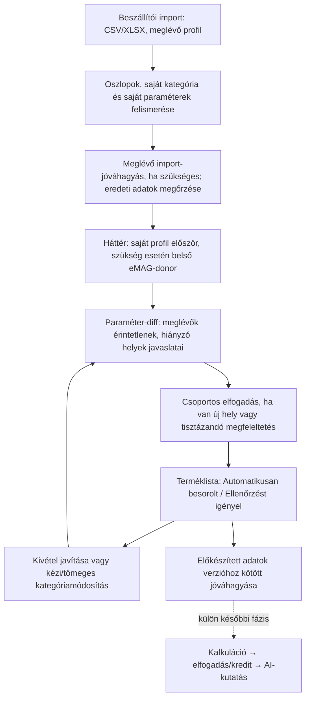

# CATEGORY-01B — kategória és paraméter-előkészítés UX/API-terve

**Állapot: jóváhagyásra váró terv; nem implementált működés.**
Feladat: [#13](https://github.com/bizsis/adatdusito/issues/13). Alap:
`80b0dce5b5270eb5de1ccecbfef5427ce35aa2c3`.
A [tételes repo-felmérés](CATEGORY-01B-INVENTORY.md) jelöli, mi létezik ténylegesen.
A backend/adatmodell terv a Claude-féle [CATEGORY-01A, #12](https://github.com/bizsis/adatdusito/issues/12)
feladata. Annak elkészült specifikációját nem tekintjük már megismertnek vagy
elfogadottnak: a két terv egyeztetése külön, jóváhagyás utáni lépés.

## 1. Magyar vezetői összefoglaló

A meglévő **Beszállítói import** és **Termékadatok** képernyőt kell bővíteni,
nem új termékkezelőt létrehozni. Az import megtartja a saját kategóriákat,
paramétereket és értékeket; az eMAG a hiányzó paraméterhelyek belső donorja lehet.
A biztos besorolások kattintás nélkül bekerülnek a terméklistába. A kezelő
elsősorban az **Ellenőrzést igényel** munkalistában dolgozik, de bármelyik termék
kategóriáját később is módosíthatja, egyenként vagy tömegesen.

Az import oszlopmegfeleltetésének jóváhagyása, a hiányzó paraméterhelyek elfogadása
és a kutatásra előkészített adatok jóváhagyása külön jelentésű döntések. A mostani
terv nem indít AI-t, kutatást, fizetést vagy kreditfogyasztást. A későbbi
kalkuláció/elfogadás csak verziózott, termékenként előkészített adatok után jöhet.

Fő hiányok: saját strukturált paraméterimport; saját kategória és donor külön
mentése; kategóriabesorolási státuszok; paraméter-diff; kézi módosításvédelem;
szerveroldali termékszűrés és biztonságos tömeges műveletek. A felmért API-k ezek
egyikét sem helyettesítik automatikusan. A következő részek **építendő** szerződések.

## 2. Változatlan alapelvek és fogalmak

| Fogalom | Jelentés és láthatóság |
| --- | --- |
| Eredeti forráskategória | A fájl kategóriaazonosítója/neve/útvonala az adott importban, változatlan eredettel. Nem lesz eMAG-azonosító. |
| Megjelenített termékkategória | Elsődlegesen az ügyfél saját kategóriája vagy annak védett kézi javítása. Ha nincs saját kategória, a jóváhagyott közös fából választható fallback. Ez látszik a terméklistában. |
| Belső paraméterdonor | Külön kapcsolat a közös, verziózott katalógus megfelelő kategóriájára és alkalmazható profiljára/profiljaira. Nem cseréli le a saját kategóriát. Részletei a „Paraméterforrás” lenyitható blokkban vannak. |
| Importprofil | Meglévő beszállítói oszlop-/fájlmegfeleltetés, pontos kapcsolási kulcs és feedbeállítás. |
| Saját kategória-/paraméterprofil | Új, ügyfélhez és forráskörnyezethez kötött definíció, paraméterkészlet és jóváhagyott megfeleltetés. Nem az importprofil vagy exportprofil átnevezése. |
| Donorprofil | Meglévő referencia-paraméterdefiníciók egy alkalmazható csoportja. Több profil külön marad, kötelezőségük és értéklistájuk nem olvad össze vakon. |
| Paraméterhely | Definícióhoz kötött mező, amelynek értéke lehet ismeretlen. Hozzáadása nem jelenti egy műszaki érték megtalálását. |

- A saját kategória/profil és a védett kézi döntés elsőbbsége már jóváhagyott elv,
  nem újra megnyitott üzleti kérdés. Névazonosság más beszállító/ügyfél között nem
  elegendő azonosságra. Saját névben lévő `/` nem bizonyít automatikusan hierarchiát.
- Az eredeti értékek megmaradnak. `0` és `false` nem hiányzó érték. Az ismeretlen
  oszlop megőrzése nem egyenlő annak jóváhagyott paraméterré alakításával.
- A 13 fix magyar főcsoport és az elfogadott közös hierarchia változatlan.
  Saját import vagy donorválasztás nem hoz létre benne új csomópontot; `is_allowed`
  nem szabályozza a fix fa vagy a saját kategória láthatóságát.
- Nincs új paraméterérték automatikus visszaírása a referenciába, nincs új eMAG-
  gyűjtés/import/aktiválás. `pinfo_db` csak olvasható; a milliós értéklistát nem másoljuk.
- A teljes ügyfél-erőforráskör jelenlegi követelményét megtartjuk. A saját munkaterület
  használata most nem indok a tenant/scope ellenőrzések eltávolítására.

## 3. Egyetlen munkafolyamat, kevés kötelező kattintás



A lista már háttérfeldolgozás közben megnyitható az elkészült termékekkel.
A diagram nem kíván minden sorra kötelező varázslót: ismert importprofil, saját
paraméterprofil és egyértelmű mapping esetén nincs termékenkénti jóváhagyás.
Ha nincs új hely, nincs külön helyhozzáadási kattintás. A bizonytalan esetek nem
állítják meg a teljes állományt; saját kategóriájuk ettől még látszik.

## 4. Képernyőnkénti terv

### S1 — Beszállítói import és forrásfelismerés

**Megmarad:** `ImportWorkspace`, uploader, importprofil, parserbeállítások,
eredeti/értelmezett előnézet, kapcsolási kulcs és pénzügyi jóváhagyás.

**Új blokk: „Kategóriák és saját paraméterek”.** Mezők:

- Kategória forrásoszlopa(i), opcionális eredeti kategóriakód, útvonalszabály csak
  kifejezett mintával; üres érték jelentése: „Nincs saját kategória”.
- Paraméterforrás módja: külön oszlopok / név–érték párok / ismert szerkezetű
  attribútummező. Az utóbbi kettő csak támogatott séma és ellenőrzött minta esetén.
- Forrásoszlop → saját paraméter neve, saját kulcsa, típusa, mértékegysége;
  eredeti minták; „Még nincs megfeleltetve”. Nem minden oszlop kötelezően paraméter.
- Meglévő saját kategória-/paraméterprofil neve és revíziója; találati indok,
  eltérések. Automatikus új profil csak javaslat, nem végleges közös séma.
- Változatlanul látható: eredeti érték → értelmezett érték; ismeretlen jelentés,
  összetett cella vagy egység esetén nem találunk ki bontási szabályt.

**Művelet:** „Megfeleltetés jóváhagyása és feldolgozás” a meglévő jóváhagyás
bővített előnézettel. Saját paraméterek új bindinglistája külön szerződés legyen,
ne kerülje meg a jelenlegi `mapping` egy-célmező-egy-oszlop ellenőrzését.
Automatikus ismételt import csak jóváhagyott, változatlan jelentésű szabállyal.
Hiányzó pénznem vagy bizonytalan árjelleg továbbra sem hagyható jóvá hallgatólagosan.

**Kivételek:** üres fájl, hibás munkalap/fejléc, kettős fejléc, profil-drift,
felcserélt név/érték oszlop, hibás azonosító, 413, megszakadt hálózat. Feltöltési
hiba nem törli a kiválasztott beszállítót és a beállításokat. Importhiba és
besorolási bizonytalanság külön jelzés; forráshibát nem „javítunk” donorválasztással.

### S2 — Feldolgozás és belső donor-egyeztetés

A meglévő futásrészlet mellett keskeny összegzés: feldolgozott/összes ismert tétel,
biztos találatok, ellenőrzendők, új paraméterhely-javaslatok; frissítés ideje.
Nem mutatunk kitalált százalékot, ha nincs megbízható nevező.

Elsőbbség: védett kézi döntés → jóváhagyott saját mapping/profil → igazolt
környezetű egyértelmű referenciaegyezés → kivétel. Az eMAG-donor választásánál
megjelenített saját kategória nem változik. Több releváns donorprofil külön
azonosítóval és alkalmazhatósággal marad meg, nem közös kötelezőmező-unióként.

Névegyezés önmagában nem elég; kategóriakörnyezet, terméktípus, ismert mapping és
kompatibilis paraméterjelentés kell. Nincs validált „85% felett mindig jó” szabály.
Pontszám csak módszer-/verziójelzéssel, kalibrált jelentéssel; különben „szabályalapú
egyértelmű egyezés” vagy „bizonytalan”. AI- és internetes kutatás itt nem indul.

Technikai futásállapotok (folyamatban/szüneteltetve/hiba) az összegző sávhoz
tartoznak. Ezek nem új termékbesorolási státuszok. Biztosan még nem elemzett
termék nem címkézhető automatikusan besoroltnak; a listában „Elemzés még folyamatban”
indokkal az ellenőrzendő csoportban, ideiglenes kézi teendő nélkül szerepelhet.

### S3 — Paraméter-összehasonlítás és hiányzó helyek elfogadása

Ugyanabban a termékrészletben, illetve kategória+profil szerint csoportosított
áttekintésben. Fejléc: saját kategória, külön donor neve/útvonala, katalógusverzió,
alkalmazható profil(ok), érintett termékszám. A forrásprofil-váltás nem ír értéket.

| Sor mezője | Megjelenítés / művelet |
| --- | --- |
| Saját paraméter és eredeti forrás | Név, saját kulcs, eredeti érték és egység, fájl/futás/sor/oszlop hivatkozás. |
| Javasolt megfeleltetés | Donorprofil + stabil paraméterazonosító, név, típus, egység; egyezés indoka és szabályverzió. |
| Diff-jelleg | Meglévő és egyező / hiányzó paraméterhely / szinonimajavaslat / ellentmondó megfeleltetés / nem ellenőrizhető. Ez sorjellemző, nem harmadik termékstátusz. |
| Kötelezőség | Saját profil szerint és donorprofil szerint külön; nincs automatikus kötelezővé tétel. |
| Kategóriaspecifikus megkötés | Meglévő `category_constraint`, ha van: például elöl-/felültöltés. A nem kompatibilis meglévő érték konfliktus, nem automatikus javítás vagy a megkötés elhagyása. |
| Megengedett értékek | Kereshető, lapozott referencia; „nincs értéklista” és „nem sikerült betölteni” külön. Nem töltődik millió érték a böngészőbe. |
| Eredményelőnézet | Megmaradó érték, új üres hely, megőrzött de ellentmondásos érték. Elfogadás nem tisztíthatja ki a meglévő értéket. |

**Szinonima/duplikáció:** típus, egység, jelentés, kategória és profil alapján
vizsgálunk. A „Kapacitás” terítékben és kg-ban nem ugyanaz. Azonos címke nem
elegendő összevonásra. Egységkonverzió csak jóváhagyott, dimenzióhelyes szabállyal,
az eredeti érték mellett. Üres és kitöltött párnál a kitöltött megmarad; két eltérő
kitöltött érték konfliktus, nem néma felülírás. Szinonimaszabály alapértelmezetten
ügyfélhez/környezethez kötött, nem minden ügyfél számára automatikusan tanult szabály.

**„Hiányzó helyek hozzáadása”**: egy előnézetben azonos sémájú csoportokra
elfogadható. Mutatja: érintett termékek, új helyek, kihagyott/védett/ütköző tételek,
és „Meglévő értékek felülírása: 0”. Nem egyszerre fogadja el a bizonytalan
szinonimákat. Elfogadás után csak üres termékhelyek jönnek létre ismétlésbiztosan;
a saját profil, más termékek és a referencia nem módosulnak automatikusan.

Ha nincs donor, a meglévő saját paraméterek olvashatók/szerkeszthetők maradnak,
a diff pedig „Paraméterforrás nem egyértelmű”. Ez nem üres, kész paraméterlista.
Katalógusváltás, termékrevízió- vagy mappingváltozás érvényteleníti a régi diffet;
új előnézet szükséges, nem régi javaslat alkalmazása az új adatra.

### S4 — Termékadatok és kivételekre koncentráló munkalista

A meglévő `ProductData` bővítése; nincs külön Marketplace-terméklista.

```text
Termékadatok   [Beszállítói import megnyitása]
[Összes: …] [Automatikusan besorolt: …] [Ellenőrzést igényel: …]
Keresés [név / SKU / EAN]  Beszállító [Mind]  Kategória [Mind]
Státusz [Mind]  Ellenőrzési ok [Mind]  Paraméterhiány [Mind]  [Szűrők törlése]
[ ]  Termék / SKU   Saját vagy fallback kategória   Státusz   Hiány   [Megnyitás]
… legfeljebb egy oldal …
[Előző] [Következő]   [Kijelölt 25] [Összes szűrt találat kijelölése: …]
```

Oszlopok: kijelölés; név/SKU (EAN opcionális részlet); beszállító; megjelenített
kategória teljes útvonala tooltipben/részletben; besorolási státusz; ellenőrzési
ok röviden; hiányzó helyek/értékek száma külön; kézi védelem ikon szöveggel;
utolsó változás. A donor nem verseng a saját kategóriával fő oszlopként.

Szűrők szerveroldalon: szöveg/azonosító, beszállító, importfutás, saját/fallback
kategória és annak hiánya, státusz, ellenőrzési ok, donor megléte/profil, hiányzó
hely/érték, védett kézi döntés, módosítási idő. A sűrűn használt szűrők elöl,
a többi a „További szűrők” blokkban. Kategória-alkategória bevonását külön jelölni.

Alapbelépés: teljes állomány. Az ellenőrzendő összegzőre kattintva kivétellista;
nem rejtjük el a biztos termékeket. Nincs soronkénti megerősítés biztos esetben.
Minden sor megnyitható, bármelyik kategória módosítható megfelelő joggal.
Kijelöléskor kontextuális tömeges sáv: kategóriamódosítás, donor javítása,
paraméterhely-előnézet, előkészítés jóváhagyása. Jogosultság nélküli írás nem ajánlható.

**A két státusz:** biztos automatikus besorolás → „Automatikusan besorolt”;
bizonytalan/hiányzó/betöltetlen megfeleltetés → „Ellenőrzést igényel”, indokkal.
A kézi javítás utáni sikeres állapot pontos felirata **D1 tulajdonosi döntés**:
nem fogunk kézi eredményt hamisan automatikusnak nevezni, és nem vezetünk be
hallgatólagosan harmadik státuszt. A javasolt gépi állapotok `assigned/needs_review`;
a közös sikeres felirat „Besorolt” csak jóváhagyás után válthatja a kért szöveget.
Addig a kézi javítás utáni felirat specifikációja nyitott, nem kész implementáció.

### S5 — Termékrészlet, kézi javítás, ellenőrzés

Ugyanazon lista mellett részletpanel; mobilon teljes szélességű részlet, visszatérés
megőrzött szűrővel/kurzorral/fókusszal. Blokkok:

1. **Termék és forrás:** név, szöveges azonosítók, aktuális munkaterület, beszállító,
   utolsó import, eredeti kategória, megjelenített kategória. A forrás nem átírható.
2. **Kategória módosítása:** saját kategória keresése/útvonala elsőként; automatikus
   fallback a meglévő közös fából csak saját hiányánál. Kézi fallback-választás saját
   kategória mellett külön, kifejezett döntés és hatáselőnézet, nem kötelező átkategorizálás;
   az eredeti saját forrás akkor is megmarad. Saját kategória másik sajátra is javítható.
3. **Paraméterforrás** lenyitható: külön donor, profilok, indok, verzió; alternatívák
   3–5-ös lapban teljes útvonallal, pontszám értelmezésével, paraméterszámmal és
   „Paraméterek megtekintése” lehetőséggel. Kiválasztás nem globális mappingváltozás.
4. **Paraméterek:** S3 diff, saját értékek, források, helyek/egységek; új üres érték
   „Ismeretlen”, nem „ellenőrzött”. Referencián kívüli meglévő érték megmarad jelzéssel.
5. **Változástörténet:** ki/mikor/mit/miért, előtte–utána, érintett revízió, import
   vagy kézi művelet, batchhivatkozás. Érzékeny adatokhoz ugyanaz a scope szükséges.

Mentés: „Módosítások előnézete” → új diff és figyelmeztetés az érvénytelenné váló
jóváhagyásról → „Mentés és védelem”. Meglévő érték nem törlődik donor- vagy
kategóriaváltástól: az új profilhoz nem illeszkedő adat elkülönített, megőrzött
saját értékként látszik. Szabad szöveges új közös kategória nem hozható létre.
„Szabály mentése ehhez a saját kategóriához” külön, nagyobb hatókörű és jogosultságú
művelet legyen, soha ne a termékmentés rejtett mellékhatása.

Nincs megfelelő alternatíva: a saját adat marad, konkrét indok menthető, a tétel
ellenőrzendő. Elavult revízió: 409, összehasonlítás az új állapottal; sem néma
újrapróbálás, sem utolsó írás nyer elv. Mentetlen űrlapnál kilépési figyelmeztetés.

### S6 — Tömeges javítás és kézi védelem

Első kijelölés csak az aktuális oldal. A „Mind a 10 000 szűrt találat” külön,
egyértelmű művelet, szerver által rögzített kiválasztási pillanatképpel. A találati
halmazt nem küldjük vissza 10 000 ID-s böngészőlistaként. Szűrő-/tenantváltás törli
a kijelölést; a futó művelet saját, rögzített célhalmazát ettől nem írja át.

Előnézet megmutatja: jogosult/érintett, védett/kihagyandó, eltérő profilú, konfliktusos
tételek számát; változó kategória/donor; megmaradó saját értékek; új hiányzó helyek.
A saját kategória és a donor külön módosítási cél. Vegyes saját kategóriákra egy
donor csak igazolt közös alkalmazhatóság vagy külön csoportok esetén alkalmazható.

Alapértelmezés: védett döntés kihagyása. Feloldás külön, jogosultságfüggő, auditált
kézi művelet indokkal, nem „force” rejtett requestflag. Importonkénti pontos
termékazonosság nélkül nem ígérünk védelmet: azonos nevű új termék nem örökölheti
véletlenül másik termék javítását. Megváltozott forráskategória javaslatként és
ütközésként kerül elő, nem írhat védett aktuális kategóriát/donort/értéket.

Nagy módosítás háttérjob: előnézeti tokenhez és revízióhoz kötött megerősítés;
feldolgozott/módosított/kihagyott/konfliktusos/hibás számlálók. Tételenként atomi,
kötött méretű kötegek javasoltak; részleges siker világosan látszik, nem „minden mentve”.
Megszakítás a hátralévő tételekre vonatkozik. Újrapróbálás csak nem alkalmazott,
ismétlésbiztos műveletre. Visszaállítás új előnézettel azóta változott rekordot nem ír felül.

### S7 — Előkészített adat jóváhagyása és a későbbi AI belépési pontja

Összegzés az aktuális termék- és sémapillanatképről: feloldott besorolások,
alkalmazható saját/donorprofilok, elfogadott helyek, megmaradó értékek, kutatandó
hiányok és még nyitott ellentmondások. „Előkészített adatok jóváhagyása” külön
művelet, nem azonos az importjóváhagyással. Teljes állomány helyett jóváhagyható
az ellenőrzött, kiválasztott részhalmaz is; a kizárás oka és száma látszik.

A hiányzó műszaki **érték** nem blokkolja a kutatásra előkészítést: éppen az lehet
a későbbi kutatás célja. Megoldatlan termékazonosság, donoralkalmazhatóság,
paraméterjelentés-/mértékegység-konfliktus vagy elavult diff viszont blokkolja az
érintett tételt. Az előkészítés nem jelent bizonyított adatminőséget vagy teljes adatlapot.

A későbbi sorrend: kalkuláció → kifejezett elfogadás/kredit → kutatás. Most nincs
aktív vagy működőnek tűnő „AI indítása” gomb, költségígéret, fizetési oldal vagy
AI-request. A tervben elkülönített csatlakozási pont: jóváhagyott revízió,
termékenkénti szükséges adatok, tiltott felülírások és hiányok. A teljes adatbázist
nem küldjük egy promptba. Az import és a besorolás nem fogyaszt sor-egyenleget;
lásd [ADR-003](../decisions/ADR-003-billing-and-processing.md).

## 5. Üres, hibás és bizonytalan helyzetek

| Helyzet | Pontos felületviselkedés |
| --- | --- |
| Nincs ügyfél / hiányos erőforrásjog | Munkaterület-választás, illetve érthető 403-szöveg; sem demo terméklista, sem auth-kerülő megoldás. |
| Nincs termék | „Még nincs importált termék” + importlink, ha van `imports.create`; olvasónál csak tájékoztatás. |
| Szűrésre nincs találat | Szűrőösszegzés és törlés; nem összetévesztendő üres adatbázissal vagy API-hibával. |
| Saját kategória van, donor nincs | Saját útvonal látszik; donor-diff ellenőrzendő. Importot nem kell megismételni. |
| Saját profil elég, eMAG-kiegészítés nem szükséges | Saját profil az elsődleges; a donor hiánya önmagában nem teszi használhatatlanná az adatot. |
| Donorprofilnak nincs paramétere | Külön „A forrás nem tartalmaz paraméterdefiníciót”; nem sikeres nulla hiány. Saját értékek maradnak. |
| Többértelmű egyezés / szinonima / duplikátum | Konkrét ok, alternatívák, eredeti értékek; nincs véletlen választás vagy adatösszevonás. |
| Referenciaverzió vagy profil változik | Aktuális termékkapcsolat eredete megmarad; új diff-javaslat, jóváhagyás nem vihető át ellenőrzés nélkül. |
| 401 / jog visszavonása / tenantváltás | Meglévő session-kezelés; tenant-cache és kijelölés törlése, késői válasz ignorálása. Írásnál a szerver újra ellenőriz. |
| 413 / HTML 502–504 / hálózati hiba | FRONTEND-02/UI-FIX-01 magyar hibái; régi adat nem látszhat friss sikernek. Lejárt POST-válasz nem indokol vak ismételt mentést. |
| 409 / lejárt bulk-token | Aktuális adatok és eltérés; új előnézet. Nincs csendes adatvesztés. |
| Részleges háttérhiba / worker újraindulás | Műveletazonosító és tételes, lapozott eredmények; folytatás/újrapróbálás nem kettőzi a helyeket vagy a mentést. |

## 6. Javasolt API-illesztés — nem létező végpontok/sémák

Az alábbi nevek **egyeztetési munkanevek**, nem implementációs megbízás vagy
végleges Claude-szerződés. A meglévő API-k a [felmérésben](CATEGORY-01B-INVENTORY.md#2-meglévő-api-k--nem-jövőbeli-végpontok)
szerepelnek. A futás, termék, paraméter és katalógus ID-ját nem mossuk össze.

| Javaslat | Rendeltetés / szükséges mezők |
| --- | --- |
| Meglévő `/imports/runs` elemzési/approval séma additív bővítése | Saját kategóriaforrás és külön `parameter_mappings[]`, saját profil/revízió; meglévő mapping/kulcs/pénzügyi döntések kompatibilisen megmaradnak. A régi kliens változatlan kérése is működjön. |
| `GET /workspace/category-options`, `/workspace/parameter-profiles` **új** | Saját kategóriák/profilok keresése és lapozása, forráskörnyezet és verzió. Donorhoz a meglévő `/reference/navigation` olvasások. |
| `GET /workspace/products` **bővítés** | Régi `items,next_cursor,field_labels` megmarad; opcionális szerveres szűrők, stabil rendezés, korlátozott lapméret, aggregált státusz-/okszámlálók. A jelenlegi kliens kurzora sem nevezhető át töréssel. |
| `GET /workspace/products/{id}` **új** | Részletes saját/forrás/fallback kategória, donor/profil, eredet, védelmek, revízió és engedélyezett műveletek. Csak egy megnyitott termék paraméterei, nem teljes készlet. |
| `PATCH /workspace/products/{id}/classification` **új** | Külön display-category és donor művelet; `expected_revision`, ok, mezőszintű változásmaszk, védelem. Válasz: új revízió és érvénytelenített előkészítés/diff. Nem hív globális `/reference/.../assignment`-et. |
| `GET /workspace/products/{id}/parameter-diff` **új** | Lapozott sorok: saját érték/definíció, donorprofil/paraméter, kötelezőség, egység, diff-ok, szabályverzió, védettség; diff-revízió/token. |
| `POST /workspace/parameter-previews` **új** | Termék vagy tokenes csoport diff-előnézete; nagy halmaznál 202 + háttérjob. Új üres helyek, kihagyások és konfliktusok összesítése. |
| `POST /workspace/parameter-previews/{id}/apply` **új** | Előnézet + revízió + idempotenciakulcs; csak elfogadott helyeket/mappingeket alkalmaz, soha nem írja át a meglévő értéket. |
| `PATCH /workspace/products/{id}/parameters/{parameter_id}` **új** | Ha a kézi értékjavítás bekerül az elfogadott első részbe: eredeti érték külön, új effective érték, indok, revízió és védelem; nincs referenciába írás. |
| `POST /workspace/product-selections` **új** | Aktuális szűrők szerveres pillanatképe; token, érintettség, lejárat, scope. Nem mindenkori élő filter azonosítója. |
| `POST /workspace/bulk-previews`, `POST /workspace/bulk-previews/{id}/apply` **új** | Típusos kategória/donor művelet, változásmaszk, előnézet, kizárások, revízió, idempotenciakulcs. Nem tetszőleges JSON mezőfelülírás. |
| `GET /workspace/operations/{id}`, `…/{id}/results`; `POST …/{id}/cancel` **új** | Scope-ellenőrzött jobállapot és számlálók, kurzoros eredmények, egyértelmű részleges siker. Létező Celery/Redis mechanizmushoz illeszthető, import-run státuszok átértelmezése nélkül. |
| `POST /workspace/preparation-approvals` **új** | Verziózott előkészített részhalmaz elfogadása, nem AI-indítás; termékenként rögzített revízió és kutatandó hiányok. |
| Termékszintű history **bővítés/új olvasás** | Import-delták mellett kézi döntés és batcheredmény, actor/idő/revízió/előtte–utána. Meglévő auditmotor újrahasznosítása. |

### Minimális UI-adatkövetelmény a CATEGORY-01A egyeztetéshez

- `product_id`, termékrevízió, beszállító és utolsó importforrás; azonosítók szövegként.
- `source_category`: eredeti kód/név/útvonal és forrásfutás; `display_category`:
  namespace + saját vagy fallback hivatkozás + útvonal + eredet.
- `parameter_donor`: külön katalógusverzió, stabil navigációs hivatkozás és alkalmazható
  profilhivatkozások. Külső eMAG ID nem helyettesít automatikusan belső ID-t.
- Két gépi besorolási csoport, `reason_codes[]`, módszer, szabályverzió, opcionális
  kalibrált confidence és korlátozott alternatívák. A confidence nem kötelező kamu százalék.
- Paraméterenként saját kulcs/definíció, raw és effective érték, típus/egység,
  referencia-kapcsolat, diff-jelleg, eredet, védelem; a követelmény profilhoz kötött.
- Előkészítési/diff-revízió és jogosult műveletek; a UI csak szerveres capability
  alapján ajánl írást, de minden írást újra engedélyez a backend.

Példa egy **szintetikus műveleti kérésre**, nem kész végponthívásra:

```json
{
  "operation": "set_parameter_donor",
  "selection_token": "synthetic-snapshot-token",
  "preview_token": "synthetic-preview-token",
  "expected_selection_revision": "synthetic-revision",
  "changes": {
    "parameter_donor": {
      "catalog_version_ref": "synthetic-catalog-version",
      "navigation_ref": "synthetic-node-ref",
      "profile_refs": ["synthetic-profile-ref"]
    }
  },
  "reason": "A kiválasztott termékek ellenőrzött közös paraméterprofilja",
  "protected_records": "skip",
  "idempotency_key": "synthetic-operation-key"
}
```

A display-category nincs a változásmaszkban, ezért nem változhat. A tokenek
scope-ját és a donor tényleges létezését a szerver ellenőrzi; a példaazonosítók
nem javasolt adatbázis-ID-k. Donor-/paraméterazonosítók végleges típusát CATEGORY-01A
határozza meg. Nem küldünk szerkeszthető tenant-ID-t jogosultságpótlékként.

### Közös szerződési garanciák

Cookie/session, CSRF, Origin és `no-store` marad. Az új írásokra javasolt képességek:
termékkategória-javítás, paraméter-javítás, tömeges módosítás és előkészítés-jóváhagyás
külön ellenőrizhetően; konkrét permission-kódok/kiosztás csak egyeztetés után.
`products.read` nem ad írást, `imports.approve` nem ad AI- vagy kategóriajóváhagyást,
és `reference.manage` nem kötelező minden termékszerkesztőnek.

Javasolt műveleti mátrix (az új jognevek még nem létező, egyeztetendő nevek):

| Művelet | Jog / további korlát |
| --- | --- |
| Lista és saját termékrészlet | Meglévő `products.read` és teljes tenant-erőforráskör. |
| Referenciafa/értéklista olvasása | Meglévő `reference.read`; ennek hiányát a kliens nem kerülheti meg. Termékszintű korlátozott donorjavaslat külön szerveres szerződésben engedélyezhető. |
| Termék saját kategóriája / donor javítása | Javasolt `products.classify`, adott termékre érvényes scope; nem közösfa-szerkesztés. |
| Kézi paraméterjavítás / helyhozzáadás | Javasolt `products.parameters.manage`, csak a D6-ban jóváhagyott funkciókra. |
| Tömeges alkalmazás | Javasolt `products.bulk.manage` **és** az adott művelet egyedi joga; a kettő nem helyettesíti egymást. |
| Előkészítési jóváhagyás | Javasolt `products.prepare.approve`; sem importjóváhagyás, sem AI/kredit engedély. |

A védelmek feloldási és kategóriaszintű szabálymentési capability-jét D4 és a
CATEGORY-01A szerződés rendezi; a fenti jogokból nem következik korlátlan feloldás.

Hibák: 401 session; 403 scope/jog; 404 idegen vagy nem látható rekord; 409 elavult
revízió/diff/token; 422 hibás művelet vagy nem alkalmazható profil; 413 feltöltés;
429 túl sűrű kérés; 503 átmeneti referencia/job hiba. Meglévő `error.message`
és a jelenlegi `error.code` kompatibilis marad; új gépi ok külön opcionális
`reason_code` mező lehet. A kliens nem kezeli a hibát üres sikernek.
POST ismétlése azonos kulccsal nem dupláz műveletet; eltérő tartalom ugyanazzal a
kulccsal konfliktus. Jogosultság változását futás közben is kezelni kell.
Szerep/scope visszavonásakor a worker a következő írási köteg előtt újra ellenőriz,
és a tiltott munkát leállítja; a már alkalmazott rész megmarad az auditban. Puszta
böngészős sessionlejárat nem azonos a háttérjob automatikus visszavonásával.

## 7. Audit, importvédelem és jóváhagyás érvényessége

Kézi döntéskor rögzítendő: actor, tenant/scope, termék és revízió, célmezők,
előtte–utána hivatkozások, indok, eredet, kapcsolódó import/diff/batch, időpont.
Nagy műveletnél összesítő esemény és lapozható tételes eredmény, nem 10 000 termék
teljes JSON-ja egy auditeseményben. Védett műszaki adatot, árat és készletet nem
szabad más ügyfelek közt automatikusan megosztani.

Új import: forrásérték frissülhet, védett effective érték nem. Eltérés számláló és
régi/új forrás összevetése jelenik meg. Védelem feloldása külön művelet. Donor,
paramétermapping, érintett érték vagy termékazonosság változása után a korábbi
előkészítési jóváhagyás nem alkalmazható új kutatási csomagra. Nem kapcsolódó
ár-/készletfrissítés hatását külön dependency-mask alapján kell eldönteni, nem minden
importtal minden jóváhagyást automatikusan eldobni (CATEGORY-01A-val egyeztetendő).

## 8. 10 000+ termékes teljesítmény- és hozzáférhetőségi terv

- Meglévő 25-ös lapozásból indulunk; a bővített lista javasolt 25/50/100-as
  szerveres limittel. Kizárólag egy oldal van a DOM-ban, nem 10 000 rejtett sor.
- Szűrés/rendezés szerveroldalon, stabil ID-tiebreakerrel. A kurzor a szűrő- és
  rendezési pillanatképhez kötött; eltérő query-vel nem vihető tovább. Új szűrő
  törli a lapozási előzményt/kijelölést. URL-ben csak nem érzékeny UI-állapot;
  session, személyes keresés vagy token nem kerül megosztható linkbe.
- Keresés 300 ms debounce; előző kérést megszakítani vagy eredményét generációval
  eldobni. Tenantváltáskor a futó kérések, kiválasztás és részlet kontextusa törlődik.
- Csak látható oldal rövid listamezői; paraméterek/diff/részletes útvonal on demand.
  Referenciaértékek alap 50/maximum 100-as külön keresése megmarad. Fa csak kibontott
  szülő gyermekeit kéri; nem nyitja ki az összes termék összes paraméterét.
- Összesítések szerveres, snapshothoz kötött mezők; drága count esetén aszinkron,
  átmenetileg „Számítás folyamatban”. Filterezett oldal elemszáma nem teljes összes.
- Tömeges kijelölés token + rövid kivétellista vagy lapnyi ID, nem 10 000 elem a
  böngészőmemóriában/requestben. Háttérfeldolgozás javasolt legfeljebb 100-as
  kötegekben; méret/index/tranzakció véglegesítése CATEGORY-01A feladata.
- Jobfigyelés csak aktív kontextusban, egy jobhoz egy időzítő. Javasolt 2–5 mp,
  rejtett lap/hálózati hiba esetén backoff; kész/hibás/jogvesztett jobnál leáll.
- 390 px-en egymás alatti filterek, név/kategória/státusz marad elsődleges;
  részletek külön panelen. A kijelölés és bulk-előnézet nem csak egérrel érhető el.
  Valódi label, billentyűfókusz-visszaadás, `aria-live` jobösszegzés, nem csak
  színkód; a Cloud & Teal tokenek és magyar Help-komponens maradnak.

**Mérendő célértékek, nem jelenlegi eredmények:** 10 000 és 50 000 szintetikus
terméken, dokumentált eszközön/CPU-n/hálózaton p95 listaválasz ≤1 s; az utolsó
billentyűtől a friss listaig ≤1,5 s a debounce-szal; lapváltás után nincs hosszú
főszál-blokk; maximum 100 DOM terméksor. Azonos lapméretnél 10k→50k növekedésre a
böngésző heap nem nőhet a teljes állománnyal arányosan; 20 lapozás után nem marad
teljes oldaltörténet-adat a memóriában. Mérni kell response bájtokat, queryszámot,
DB-tervet, heapet, CPU-t és aktív időzítőket; küszöbértékeket a próbamérés után
véglegesíteni. Ezzel a tervvel most nem állítunk VPS-terhelési eredményt.

## 9. Nyitott üzleti döntések és CATEGORY-01A illesztési lista

| ID | Jóváhagyandó döntés / ajánlás |
| --- | --- |
| D1 | Két csoport maradjon, de a sikeres csoport felirata lehet-e „Besorolt”, mellette automatikus/kézi eredet? Ajánlott, hogy a kézi javítás ne kapjon hamis automatikus címkét. A kért két megnevezést most nem változtatjuk meg. |
| D2 | Mely kalibrált szabályok mellett automatikus egy donor/mapping? Tulajdonos által elfogadott hibaköltség, kategóriakörönkénti validáció és ismeretlenben kivétel; nincs most kitalált százalékküszöb. |
| D3 | Hiányzó üres paraméterhelyek elfogadása: ajánlott egy csoportos, verzióhoz kötött előnézet, nem termékenkénti kattintás. Engedélyezhető-e később előre jóváhagyott profilon automatikus helyhozzáadás? Alapból nem. |
| D4 | Ki oldhat fel kézi védelmet, és ki menthet ügyfél-kategóriára kiterjedő szabályt? Ajánlott külön scope/jog és indok; meglévő szerepekhez ne rendeljünk új hatalmat hallgatólagosan. |
| D5 | Bulk-részleges siker és visszaállítás elfogadása: javasolt tételenként atomi, auditált módosítás, azóta változott tétel kihagyásával; nem teljes 10k-s hosszú tranzakció. |
| D6 | Kézi paraméterérték-szerkesztés az első implementáció része legyen-e, vagy csak a kategória/donor/mapping javítása? A meglévő saját érték megőrzése mindkét esetben kötelező. |

Claude-val később egyeztetendő: termék-ID/azonosság élettartama; saját kategória
és effektív kategória modellje; saját profil-/paraméter-bindingok; donor és
katalógusverzió; paraméterhely-egyediség; revízió/idempotencia; bulk-snapshot TTL;
joberedmények és részleges siker; field-level lock és auditmegőrzés; keresési
indexek/aggregáció; capability/jogkódok; előkészítési dependency-mask és termékenkénti
későbbi kutatási payload. A mostani dokumentum ezekre UI-követelményt ad, nem SQL-t,
Alembic-sorszámot vagy jóváhagyott végleges API-t.

## 10. Elfogadási és frontend tesztterv

Az alábbiak **új, az implementációval megírandó tesztek**, nem most teljesített
üzleti elfogadások. A jelenlegi regressziók a felmérésben vannak felsorolva.

| ID | Eset és ellenőrizhető eredmény |
| --- | --- |
| T1 | CSV és XLSX saját kategóriával, 10 külön paraméteroszloppal: eredeti kategória/érték/egység és ismeretlen oszlop megmarad; nincs eMAG-ra átnevezés. |
| T2 | Jóváhagyott saját profil + ismert mapping: nincs termékenkénti kattintás; hiányzó saját kategóriánál fallback megjelenik, donor ettől külön mentődik. |
| T3 | Saját „TV” kategória, belső Televíziók donor: a saját útvonal változatlan; a referencia 46 elemű **szintetikus fixture** esetén 46 definíció elérhető. Ez nem aktuális VPS-darabszám állítása. |
| T4 | Egyértelmű/ambivalens/nincs donor: megfelelő két csoport és konkrét ok/alternatívák; a kézzel javított sor a D1-ben jóváhagyott szöveget kapja, nem hamis automatikus eredetet. |
| T5 | Szinonima azonos jelentéssel és egységgel: egy hely; azonos név más jelentéssel/egységgel: konfliktus. `0`, `false`, üres és whitespace külön teszt. |
| T6 | Több donorprofil: kötelező jelölések és értéklisták külön; profilválasztás nem írja át a saját kategóriát/értéket vagy a közös fa globális mappingjét. |
| T7 | Helyhozzáadás ismételve: nulla duplikátum, nulla meglévőérték-felülírás; donoron kívüli meglévő érték sem törlődik. |
| T8 | Kézi kategória/donor/érték után új, pontos kulcsú import: effective döntés védett, új forráseltérés látható/auditált. Hasonló név/pontos kulcs hiánya nem írhat más termékbe. |
| T9 | Két kezelő, eltérő revízió; régi diff/bulk-token; katalógusváltás: 409 és új előnézet, nem elveszett friss módosítás. |
| T10 | Kiválasztás egy oldal / minden szűrt találat: pontos scope és count; szűrőváltás töröl, később importált találat nem kerül régi snapshotba; védett/tiltott tételek számláltan kimaradnak. |
| T11 | Háttérjob részleges hibával és worker újraindulással: tételes eredmények, folytatás nem dupláz, megszakítás nem állítja vissza az alkalmazott sorokat. |
| T12 | Másik tenant, selected-resource fiók, jogvisszavonás, CSRF és megszorított MFA-session: API nem enged tiltott írást, UI nem jelenít meg másik ügyfél adatát. |
| T13 | 413 HTML, üres/malformed JSON 502–504, 401, 403, 422, 429, 503: magyar hiba, nincs hamis siker; régi válasz nem állítja vissza másik tenant termékét. |
| T14 | 10k/50k termék és milliós referenciaérték-fixture: legfeljebb lapnyi DOM, korlátozott payload, szerveres szűrés; a 8. fejezet mérőszámai dokumentálva. |
| T15 | 390 és 1440 px, billentyűzet és képernyőolvasó: kereső, fa, diff, bulk-előnézet, fókusszal visszatérés és hibahelyek használhatók. |
| T16 | Előkészítés hiányzó értékekkel megengedett, megoldatlan jelentéskonfliktussal az érintett sor kizárt; későbbi kalkuláció/AI/billing végpont egyáltalán nem hívódik. |
| T17 | Kategóriaspecifikus donor-megkötés és ellentétes saját érték: az eredeti érték megmarad, a konfliktus megjelenik; sem a forrásérték, sem a referenciamegkötés nem íródik át. |

Implementációs bontási javaslat jóváhagyás után: (1) kompatibilis saját adat-/mapping-
szerződés és forrásimport; (2) szerveres szűrés + lista/részlet; (3) donor és diff;
(4) kézi védelem/revízió; (5) bulk-előnézet és háttérművelet; (6) előkészítési
jóváhagyás. Minden részhez saját backend/scope és frontend teszt, migráció csak a
koordinátor kiosztásával. A kutatás, kredit és külső ügyfélkezelés későbbi külön fázis.

## 11. E feladat határa és átadása

Ez a branch csak ezt a tervet és a felmérést dokumentálja. Nem módosít frontend-
vagy backendkódot, API-t, jogosultságot, adatot, migrációt, titkot vagy infrastruktúrát.
A vizsgálat regressziós eredményei a PR-átadásban szerepelnek; nem minősülnek az új
képességek elfogadási tesztjének. Nincs main-merge vagy VPS-telepítés.

E branch helyi ellenőrzése: `pytest` a meglévő backend/tooling csomagon **364**,
a meglévő böngésző/export csomagon **44** sikeres teszt; `npm ci` és `npm run build`
(TypeScript + Vite) sikeres. Két meglévő Starlette/httpx/AnyIO deprecation
figyelmeztetés maradt. Az új T1–T17 üzleti tesztek nincsenek implementálva;
az új képességek jóváhagyása és megépítése után szükségesek.
